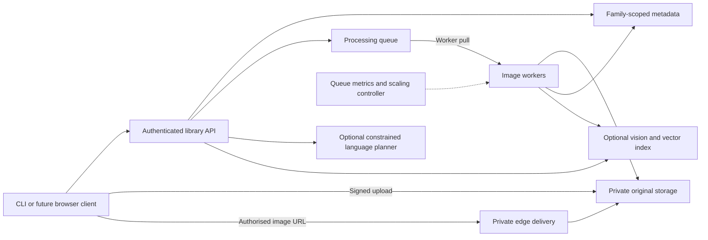
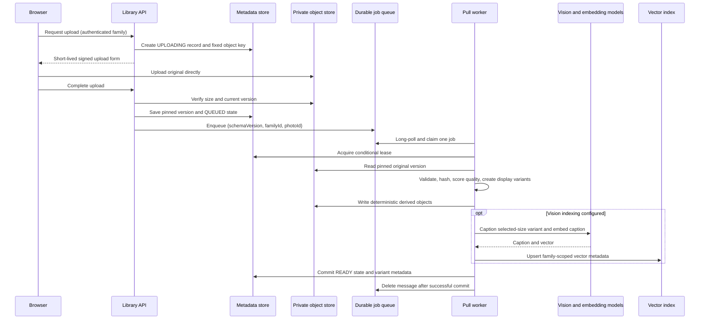

> Current cache architecture: process-local bounded photo-list cache in the API,
> not CloudFront. See deployment-progress.md for TTL, invalidation, privacy checks,
> limits and the observed account-policy reason. The CDN diagram below is the initial
> rejected design and must be replaced in the final report.

> Deployment update (2026-10-22): see [validation](validation.md) for actual progress.
> The course account denies bucket versioning. For unversioned originals, completion
> now uses an ETag-conditional copy to a fresh server-controlled key. This prevents a
> still-valid upload form from overwriting the worker input, but retains an extra
> staging copy and is not S3 Object Lock or protection from privileged administrators.
> Earlier version-pinning and undeployed statements below describe the initial plan.

# Architecture working notes

These are implementation notes for development, not report prose or deployment evidence.

## Upload and indexing workflow

The browser never proxies image bytes through the API. This reduces API bandwidth
and lets object storage absorb upload concurrency. The queue separates user-facing
upload latency from CPU/AI work. The metadata record remains authoritative: vector
search first applies a family filter, then checks each hit against the caller's
family membership and current READY photo record. A stale or trashed vector cannot
reintroduce a photo into user-visible results.

S3 Vectors stores semantic caption embeddings, not the original image and not a
visual duplicate fingerprint. Exact-file detection uses SHA-256 and near-duplicate
review uses a deterministic difference hash within same-day candidates. This keeps
similarity warnings explainable and non-destructive. Vision indexing is optional
because each invocation adds model latency and cost; without approved model access,
ordinary upload, resize, quality review and date/person-based albums still work.

Local adapters use SQLite, filesystem objects and a durable queue. They let API and
worker run in separate processes but are not intended for distributed cloud storage.
AWS adapters use DynamoDB, S3, SQS and ECS/Fargate. Optional image delivery uses
CloudFront OAC and signed URLs. Cognito authenticates users; membership records
authorise family actions.

## Data and consistency

DynamoDB uses `pk=FAMILY#<id>` and sort keys `MEMBER#`, `PHOTO#`, `ALBUM#`,
`RECREATION#`. A revision guards each update. This single-family partition design
is adequate for the initial small dataset but needs access-pattern and hot-partition
review before commercial scale. Family listing and queries currently retrieve all
matching records; pagination and date/quality indexes are follow-up work.

The completed S3 upload is pinned to a version. Original retention therefore must
not automatically expire noncurrent versions referenced by photo records. Derived
objects use deterministic per-photo keys and may be safely overwritten by a retry.
EXIF orientation is applied before variant generation; the original is preserved.
Derived JPEGs do not carry the source EXIF metadata.

## Scaling and fault handling

The worker receives one message at a time, renews SQS visibility and its database
lease, and uses ECS task scale-in protection while processing. SIGTERM stops future
polling and allows current work to drain within the platform stop window. Unexpected
termination can cause replay; conditional updates and stable output keys limit damage.
External model calls may still be repeated after a crash. Exactly-once execution is
not claimed.

The initial scaling policy adds a worker when queued work exists, with a maximum of
four. It scales to zero only after five consecutive empty periods considering visible,
in-flight and delayed messages. These are initial experiment settings, not tuned
service-level guarantees. API CPU scaling is independent. Record actual running
tasks and scaling activities during evaluation; templates alone are not evidence.

## Cache and deletion

CloudFront verifies signed URLs and uses OAC to fetch only `derived/*` from S3.
The optional distribution uses the AWS managed CachingOptimized cache policy.
The API emits short-lived URLs only after membership and READY-state checks.
Logical deletion prevents new URLs but cannot revoke an already-issued URL before
its expiry. Existing browser downloads cannot be recalled. Permanent deletion,
cache invalidation and orphan cleanup are future coordinated workflows.

