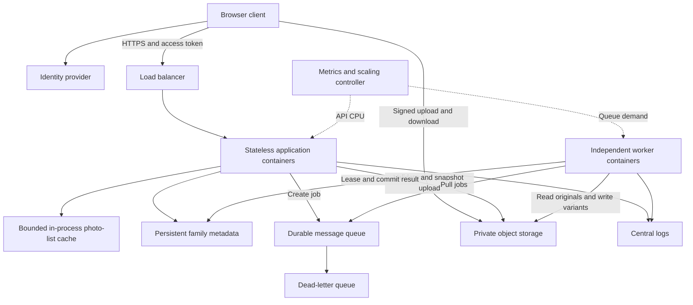
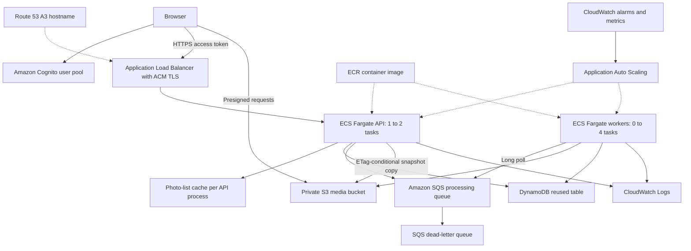

# Implemented architecture (2026-10-22)

This describes the deployed image a3-cache-20261022-191134. The optional AI paths
are not part of the verified workflow. Earlier architecture notes describe a rejected
CDN design; use this document for the current report diagrams. Mermaid diagrams are
working sources: render and check legibility at A4 size before inserting them into the
report. The AWS report figure still needs appropriate AWS service icons.

## Vendor-independent design

The API accepts work without waiting for image processing. The durable queue absorbs
bursts and decouples user requests from processing capacity. Workers pull one job at a
time, acquire a conditional metadata lease and acknowledge only after committing the
result. Retries and deterministic output paths mitigate duplicate delivery; this is
not an exactly-once delivery guarantee. A failed enqueue is recoverable by retrying
completion. The object store holds image bytes while the database holds ownership,
state and variant references.

## AWS implementation

Resources are deployed in ap-southeast-2. Cognito access tokens are verified by the
API, and family membership is checked before every cached or uncached photo-list
response. Original and derived image downloads use short-lived signed S3 URLs.
There is no active CloudFront distribution. The shared course task role and security
group are reused: API and worker do not have separately scoped IAM roles, and the
shared security group does not enforce ALB-only access to port 8080. These are real
implementation constraints, not least-privilege claims.

Worker scale-out uses visible queue depth and increases desired capacity by one,
subject to its cooldown and maximum of four. Scale-in requires five idle periods
covering visible, in-flight and delayed messages. Zero workers saves idle compute
cost but introduces a cold-start delay. CloudWatch sampling, provisioning and image
startup contribute to that delay. API minimum capacity is one, so the entire system
does not scale to zero. The load balancer also has a continuing cost.

## Cache semantics and evidence

The cache holds serialized photo lists for five seconds, at most 64 entries and
8 MiB of response bodies, with LRU eviction. The cache key includes family and trash
view. Local API writes invalidate family entries; a generation check rejects a stale
in-flight fill. Worker writes and writes through another API instance can remain
stale until expiry. Membership and JWT checks still execute on a cache hit, and
individual-photo status requests are uncached. Browser caching is disabled.

The live evidence in evidence/cloud-cache-verification.json records MISS, HIT,
MISS after TTL and MISS after metadata mutation, plus a successful original download
and rejection of unauthenticated access. Timing differences from this single sequence
are observations, not a benchmark. An in-process cache is disposable, so restarting
or replacing a task loses its cached data without losing persisted photos.

## Evidence boundary

The single-job experiment verified an asynchronous 202 response, eventual READY,
three generated variants and automatic worker desired count 0 -> 1 -> 0. The 48-photo batch observed running workers 0 -> 1 -> 2 -> 0 and all photos READY.
The second worker started after processing completed, so this does not establish
improved parallel throughput. See evidence/cloud-batch-summary.json. No 50-user capacity result, monthly price, AI accuracy or fault-injection
result has yet been established. The report must discuss retained staging copies,
logs without expiry under course restrictions, and shared-role/security-group limits.

## Long-idle queue wake-up limitation

The batch experiment initially observed 48 queued jobs while worker desired/running
counts remained zero and the busy alarm still referenced an earlier datapoint.
This is consistent with a documented SQS limitation: after more than six hours of
inactivity, metrics stop; resuming publication may take up to 15 minutes after
reactivation. This is an interpretation of the observation, not proof of the exact
internal cause. See [AWS SQS monitoring documentation](https://docs.aws.amazon.com/AWSSimpleQueueService/latest/SQSDeveloperGuide/monitoring-using-cloudwatch.html).

The present design therefore does not promise immediate processing after long idle
periods. Keeping a worker running, publishing a custom demand signal, or introducing
an explicit wake-up mechanism are possible future alternatives with additional cost
or complexity. None of these alternatives was implemented during the experiment.
